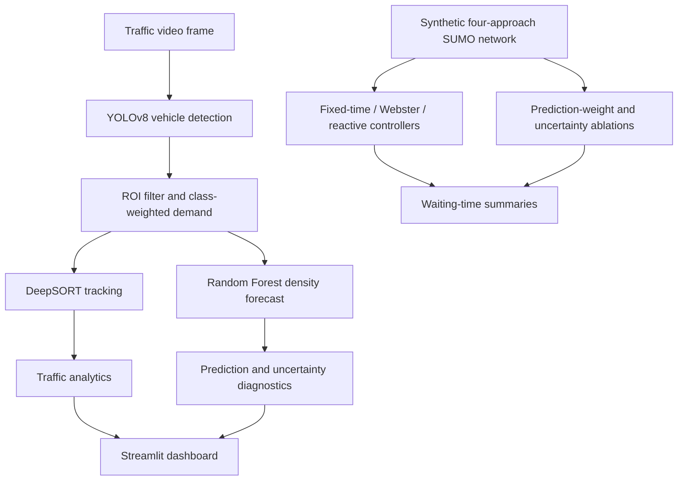

# AI Traffic Congestion Detection & Adaptive Signal Control

**Research prototype for short-horizon traffic-demand prediction and adaptive traffic-signal control.** The project combines YOLOv8 vehicle detection, DeepSORT tracking, ROI-based weighted demand estimation, a Random Forest (RF) density predictor, a Streamlit intersection dashboard, and microscopic traffic-control experiments in SUMO.

[](https://www.python.org/)
[](LICENSE)
[](https://github.com/Aaabhi0406/adaptive-traffic-signal-control/actions/workflows/ci.yml)

> **Research status:** prototype / experimental. This repository does not demonstrate deployment on a live traffic signal or validation using four synchronized real-world cameras. The dashboard and controller architecture support four approaches, but the available video and SUMO experiments have different sensing setups and must be interpreted separately.

## Table of contents

- [Research question](#research-question)
- [System overview](#system-overview)
- [Key components](#key-components)
- [Experimental results](#experimental-results)
- [Installation](#installation)
- [Run the application](#run-the-application)
- [Reproduce the experiments](#reproduce-the-experiments)
- [Repository structure](#repository-structure)
- [Limitations and responsible use](#limitations-and-responsible-use)
- [Citation and license](#citation-and-license)

## Research question

**When does short-horizon predicted traffic demand help adaptive signal control, and does a simple uncertainty adjustment add value?**

The working paper title is *Short-Horizon Demand Prediction for Adaptive Traffic Signal Control: A Regime-Dependent Evaluation in SUMO*. The project deliberately evaluates the detector/predictor and the SUMO controller experiments as separate components rather than claiming end-to-end real-world validation.

## System overview



The video branch estimates traffic demand from visual detections. The SUMO predictive-control ablations use SUMO's own per-approach halting-vehicle counts as **surrogate sensing**; they do not feed YOLO video detections directly into SUMO. The forecasting horizon also has different units in these experiments: 15 frames for video, versus 15 one-second SUMO ticks for the simulator.

## Key components

- **Detection:** Ultralytics YOLOv8 detects vehicle classes in each processed frame.
- **Tracking:** DeepSORT maintains object tracks and supports traffic-flow analytics.
- **Demand estimation:** vehicles inside a configurable region of interest contribute to a class-weighted density signal. This is a detector-derived proxy, not manually labelled ground truth.
- **Forecasting:** a Random Forest predicts density 15 frames/steps ahead from a rolling feature window. During startup, the predictor falls back to a simpler estimate while collecting sufficient history.
- **Intersection control:** demand is combined at the intersection level. The conflict-safe phase controller uses NS/EW green phases with yellow and all-red clearance phases; it is a research controller, not a hardware-certified signal controller.
- **Dashboard:** Streamlit provides a visual interface for inspecting the traffic pipeline and intersection-level behaviour.
- **SUMO evaluation:** fixed-time, classical Webster, reactive, and prediction-guided strategies are compared across four synthetic demand regimes.

## Experimental results

### SUMO baseline comparison

The table reports the mean accumulated approach-edge waiting-time metric produced by the current SUMO implementation over **five seeds per scenario and 900 simulated seconds per run**. Lower is better. Values are not conventional trip delay; see [`docs/EXPERIMENTAL_RESULTS.md`](docs/EXPERIMENTAL_RESULTS.md) for the metric definition, raw runs, and fairness caveats.

| Demand regime | Fixed-time | Webster | Reactive | Best mean in this run |
|---|---:|---:|---:|---|
| Balanced | 22,260.8 | 12,396.6 | **8,856.6** | Reactive |
| N/S-heavy | 22,287.6 | **9,566.0** | 9,819.0 | Webster |
| E/W-heavy | 21,098.2 | **7,616.2** | 10,164.2 | Webster |
| Asymmetric | 17,490.0 | **5,891.2** | 7,002.2 | Webster |

Reactive control is lower than fixed-time in all four scenarios. Classical Webster is lower than reactive in three scenarios, while reactive is best in the balanced scenario. The controllers are not perfectly like-for-like: the adaptive controller includes a 2-second all-red clearance, while the recorded fixed-time/Webster baselines did not use that clearance; Webster also uses the generated scenario arrival rates. Interpret these comparisons as experimental evidence from this simulator, not proof of real-road performance.

### Prediction-guided control and uncertainty

A prediction weight of 0.25 was tested as a conservative setting. Across five seeds, the 25%-prediction controller improved the mean metric in the balanced and E/W-heavy scenarios, but was worse in the N/S-heavy and asymmetric scenarios. Its equal-scenario mean was **1.76% worse** than reactive control. The simple RF upper-bound uncertainty adjustment was **7.41% worse overall** than the 25%-prediction point estimate in the recorded ablation and was not consistently beneficial in individual scenarios.

The 0.25 setting was chosen after an initial seed-0 sensitivity sweep; the subsequent five-seed evaluation includes that seed, so it is not a fully independent holdout evaluation. Full summaries and raw CSVs are in [`results/`](results/) and [`docs/EXPERIMENTAL_RESULTS.md`](docs/EXPERIMENTAL_RESULTS.md).

### Video forecasting diagnostics

Two short traffic clips were evaluated online, with each forecast matched to the detector-derived weighted density observed 15 frames later. On the trained portions, RF achieved lower MAE than the EMA baseline in both clips, but both trained-subset R² values were negative. The full matched sample included startup predictions from before RF training; on the second clip, RF and EMA were effectively tied over the full sample. The interval coverage was 70.20% on Video 1 and 56.95% on Video 2, so the tree-spread upper bound should be treated as a heuristic rather than a calibrated prediction interval.

These data show a preliminary two-clip diagnostic only. There is no manual density ground truth, no detector/tracker accuracy benchmark, and no claim of generalization to other locations, weather, or camera angles. See [`docs/EXPERIMENTAL_RESULTS.md`](docs/EXPERIMENTAL_RESULTS.md) for MAE, RMSE, R², interval coverage, and the trained/full-sample split.

## Installation

### Requirements

- Python 3.10 or newer
- Windows, Linux, or macOS
- Internet access on the first run if Ultralytics needs to download model weights
- SUMO installed separately only for microscopic simulation experiments

### Windows (PowerShell)

```powershell
git clone https://github.com/Aaabhi0406/adaptive-traffic-signal-control.git
cd adaptive-traffic-signal-control

py -3.10 -m venv .venv
.\.venv\Scripts\Activate.ps1
python -m pip install --upgrade pip
pip install -r requirements.txt
pip install -e .
```

If PowerShell blocks virtual-environment activation, consult the Python/PowerShell policy used on your machine; do not disable security controls globally just to run this project. You may alternatively invoke `\.venv\Scripts\python.exe` directly.

### Linux / macOS

```bash
git clone https://github.com/Aaabhi0406/adaptive-traffic-signal-control.git
cd adaptive-traffic-signal-control
python3 -m venv .venv
source .venv/bin/activate
python -m pip install --upgrade pip
pip install -r requirements.txt
pip install -e .
```

## Run the application

### Four-way intersection dashboard

```bash
streamlit run src/traffic_system/dashboard_intersection.py
```

Open the local URL printed by Streamlit, usually `http://localhost:8501`.

### Single-video dashboard

```bash
streamlit run src/traffic_system/dashboard.py
```

### OpenCV CLI

Place a video file you are licensed to use in `videos/`, then run:

```bash
python -m traffic_system.cli videos/your_clip.mp4
```

Video files, downloaded model weights, virtual environments, and generated SUMO route files are excluded from Git. Supply your own appropriately licensed video clips.

## Reproduce the experiments

### Video RF-versus-EMA evaluation

```bash
python scripts/capture_rf_eval.py videos/your_clip.mp4 --output results/rf_eval.csv
```

The script performs online evaluation on the same clip: each prediction uses past/current information available at its forecast time and is matched to the detector-derived density 15 frames later. The target is not a human-annotated vehicle count. The pre-computed two-clip outputs in `results/` are included for inspection; the original video files are not distributed in this repository.

### SUMO baseline experiment

Install SUMO first, then check that the `sumo` executable is available and that the SUMO tools can be found by Python. See [`sumo_env/README.md`](sumo_env/README.md) and the official [SUMO installation documentation](https://sumo.dlr.de/docs/Installing/index.html).

Run one fixed/Webster/reactive scenario:

```bash
python scripts/sumo_reactive_benchmark.py --duration 900 --seed 0 --rate N=5 --rate E=5 --rate S=5 --rate W=5
```

### SUMO prediction-weight ablation

```bash
python scripts/sumo_prediction_weight_sensitivity.py --run-all-seeds --duration 900 --seeds 0 1 2 3 4
```

### SUMO RF point-estimate versus uncertainty adjustment

```bash
python scripts/sumo_25pct_uncertainty_ablation.py --run-all --duration 900 --seeds 0 1 2 3 4
```

### SUMO 50%-weight predictive ablation

```bash
python scripts/sumo_predictive_benchmark.py --run-all --duration 900 --seeds 0 1 2 3 4
```

The multi-seed experiments can take substantial time and require SUMO separately from Python packages. Generated route files and fresh outputs will be written under `sumo_env/` and `results/` as configured in each script.

### Tests and lint

```bash
pip install pytest ruff
pytest tests/ -v
ruff check src/ tests/ scripts/
```

SUMO integration tests require SUMO; environment-dependent tests may skip when it is unavailable. CI focuses on lightweight tests and does not download YOLO weights or run a full SUMO experiment.

## Repository structure

```text
src/traffic_system/       Detection, tracking, forecasting, intersection and dashboard code
scripts/                  Video evaluation and SUMO benchmark/ablation scripts
results/                  CSV evaluation outputs and summaries
sumo_env/                 Synthetic SUMO network and setup notes
tests/                    Unit and integration tests
docs/                     Architecture, project status and experimental results
assets/                   Optional project assets; no placeholder demo GIF is required
```

## Limitations and responsible use

- The SUMO road network is a synthetic four-arm intersection; its geometry and vehicle-arrival processes are not a measured real junction.
- The SUMO predictive ablations use simulated queue counts as surrogate sensing. They are not an end-to-end video-to-SUMO test.
- Video evaluation covers two short clips. Target values are generated by the same detection pipeline and are not independent ground truth.
- The uncertainty bound is based on Random Forest tree disagreement and is not calibrated. Its contribution to control was not consistently positive.
- The best predictive weighting changes with the demand regime; the tested prediction-guided policy did not outperform reactive control across all scenarios.
- No live traffic hardware is connected. Do not connect this research prototype to a public-road signal without independent validation, traffic-engineering review, fail-safe design, and relevant approvals.

The main research finding is therefore deliberately narrow: **the effect of short-horizon prediction on simulated adaptive signal control is demand-regime dependent, and the tested simple uncertainty adjustment does not provide a consistent benefit.**

## Citation and license

If you use or extend this code, please cite the software using [`CITATION.cff`](CITATION.cff). The repository is released under the MIT License; see [`LICENSE`](LICENSE).

**Maintainer:** Abhinav Nitin Mohurle
